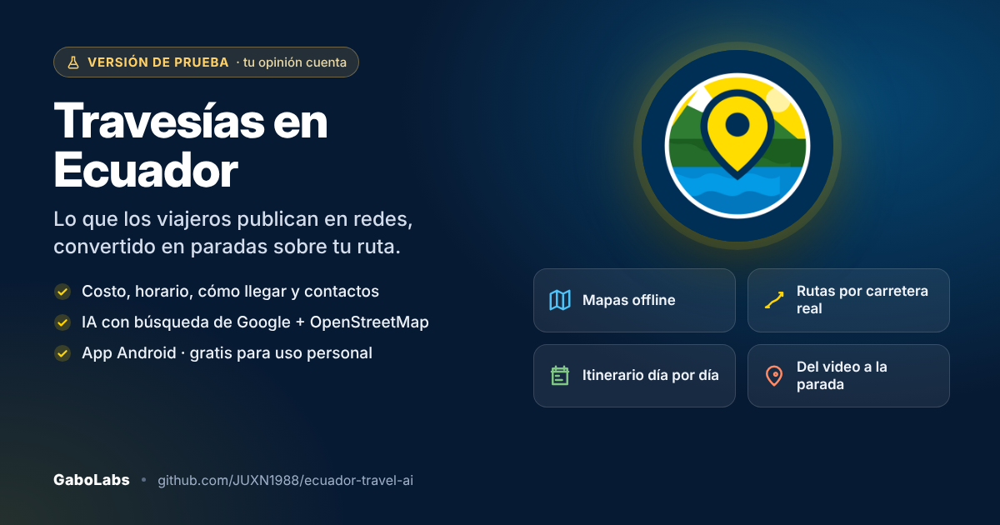

# Travesías en Ecuador 🇪🇨



App Android (Kotlin + Jetpack Compose) que convierte lo que los viajeros publican en redes sociales en **paradas reales sobre el mapa de tu ruta**, con costo, horario, cómo llegar, contactos y mapa offline, y te deja armar el itinerario día por día junto a tus compañeros de viaje.

> 🧪 **Versión de prueba.** La app funciona, pero la sigo mejorando y quiero hacerlo con quienes viajan por Ecuador.
> ¿Qué falló o qué le agregarías? [Reporta un error](https://github.com/JUXN1988/ecuador-travel-ai/issues/new?template=bug_report.yml) o [sugiere una mejora](https://github.com/JUXN1988/ecuador-travel-ai/issues/new?template=feature_request.yml). Leo todas las sugerencias.
>
> 🔑 Este repositorio **no incluye claves de API ni la llave de firma**: usa las tuyas (ver *Cómo compilar*).

## Qué hace

| Módulo | Qué hace |
|---|---|
| **Inicio** | Una sola pantalla: **“¿A dónde vas?”** con destino obligatorio, salida opcional, días y viajeros. Si no hay salida, la app busca **solo alrededor del destino** (radio ajustable) y no inventa una ruta. Desde ahí arranca la IA, el mapa y Mi Ruta; si ya hay viaje, muestra la siguiente parada. Los demás accesos están en una fila compacta. |
| **Mapa** (OpenStreetMap / osmdroid) | Marca todos los lugares por categoría, dibuja tu ruta por carretera real (OSRM), muestra el corredor del radar o el círculo de búsqueda, tu ubicación, y al tocar un marcador abre la tarjeta completa. Las paradas van **numeradas**, la siguiente en rojo, con progreso, botón “Ir” y “Ver toda mi ruta”. Se descarga por zonas para usarlo **sin señal**. |
| **Descubrir → Planear viaje** | Indicas *desde dónde* (opcional) y *hasta dónde* vas y qué te interesa. La app combina **Gemini 2.5 con búsqueda de Google** (TikTok, Instagram, Facebook, YouTube, blogs y prensa) con el **explorador de OpenStreetMap**: la IA dice qué está de moda y el mapa aporta todos los lugares reales de la vía y del destino. Los que no entran al itinerario quedan como **sugerencias** para añadir antes de guardar. |
| **Tarjeta de lugar** | Foto, categoría, nivel de verificación, costo USD, horario, altitud, calificación, dirección, descripción, cómo llegar y transporte, mini-mapa offline con coordenadas, botones de **llamar / WhatsApp / web / Instagram / TikTok / Facebook**, navegación con tu app de mapas, fuentes citadas, tips, compartir. |
| **Mi Ruta** | Constructor de itinerario: paradas por día, orden (subir/bajar/mover de día), hora, duración, costo, notas, check de completado; distancia y tiempo de conducción reales; **Optimizar con IA** (reparte por días y orden geográfico); descarga del mapa offline de la ruta; exportar itinerario por WhatsApp; compartir al grupo. |
| **Compartir → Travesías** | Desde TikTok, Instagram, Facebook, YouTube, Chrome o WhatsApp tocas *Compartir → Añadir a Travesías*: la IA lee la publicación, identifica el lugar, lo ubica y lo deja listo para tu ruta. |
| **Comunidad** | Registro **solo con nombre de usuario** (Firebase Auth anónimo). Grupos de compañeros con código de invitación: chat, compartir lugares y rutas (se copian a tu app con un toque). **Compañeros afines**: viajeros con tus mismos gustos, región, destino o mes de viaje. |
| **Guía IA** | Chat con búsqueda web para precios, buses, clima, altitud, seguridad y gastronomía. Respuestas offline si no hay red. |
| **Kit de viaje** | Mapas offline por región (descarga real de teselas), emergencias con llamada directa (ECU 911, Policía Turística…), guía de altitud/soroche, lista de equipaje, calculadora de presupuesto. |
| **Planificador IA** | Genera un itinerario completo por región/días/estilo con Plan A / Plan B por clima. |

Todo se guarda en **Room (SQLite)**: lugares, rutas, paradas y caché del radar funcionan sin conexión.

## Cómo compilar

**Requisitos:** Android Studio (Ladybug o superior) con Android SDK 36, o JDK 17+ y el SDK por separado.

1. Copia `.env.example` a `.env` y pega tu clave:
   ```
   GEMINI_API_KEY=tu_clave      # obligatoria para la IA → https://aistudio.google.com/apikey
   YOUTUBE_API_KEY=             # opcional (videos reales por parada)
   PLACES_API_KEY=              # opcional (teléfono, horario, reseñas, fotos)
   ```
2. *(Opcional, para Comunidad)* crea un proyecto en [Firebase](https://console.firebase.google.com), añade una app Android con paquete `ec.travesias.app`, descarga `google-services.json` a `app/`, y activa **Authentication → Anónimo** y **Cloud Firestore**. Sin este archivo la app compila igual y la pestaña Comunidad muestra las instrucciones.
3. Compila:
   - **Windows:** `.\build_release.ps1` (PowerShell). Añade `-Debug` para el APK de pruebas o `-Install` para instalarlo por USB.
   - **Linux/macOS:** `./build_release.sh`
   - **Android Studio:** *Open* → carpeta del proyecto → *Run*.

El script crea la clave de firma (`travesias-upload-key.jks` + `keystore.properties`) la primera vez, compila `bundleRelease` + `assembleRelease` y deja en `release/`:
- `TravesiasEnEcuador-vX.Y.Z-N-fecha.aab` → **sube este archivo a Google Play Console**.
- `TravesiasEnEcuador-vX.Y.Z-N-fecha.apk` → instalar directo en el teléfono.

> ⚠️ Respalda `travesias-upload-key.jks` y `keystore.properties`. Sin ellos no podrás publicar actualizaciones. Nunca los subas a Git (ya están en `.gitignore`).

## Checklist para Google Play

- [x] `applicationId` propio (`ec.travesias.app`), `targetSdk 36`, AAB firmado con clave de subida.
- [x] Permisos mínimos: Internet, red y ubicación (opcional, solicitada en tiempo de ejecución).
- [ ] En Play Console: ficha de la tienda (nombre, descripción, capturas, ícono 512 px), **Seguridad de datos** (declara: ubicación aproximada/precisa opcional, identificadores de usuario si usas Comunidad, datos enviados a Google Gemini/Places/YouTube y OpenStreetMap/Nominatim/OSRM), **Política de privacidad** (URL obligatoria), clasificación de contenido.
- [ ] Sube el `.aab` a *Pruebas internas* primero y luego a *Producción*.
- [ ] Para cada versión nueva, aumenta `versionCode` (y `versionName`) en `app/build.gradle.kts`.

## Comunidad: dónde se guarda cada cosa

La comunidad es **local-first**: perfil, grupos, mensajes, fotos y ubicaciones se guardan en
la base de datos Room del propio teléfono (`my_profile`, `social_groups`, `social_posts`).
Firebase actúa solo como **conector**: replica esas mismas filas para que el resto del grupo
las vea y trae las suyas. Sin internet la app sigue funcionando y lo pendiente se envía al
reconectar (`pendingSync`).

Las **fotos originales nunca salen del teléfono** (`app/files/fotos/`). Lo único que viaja es
una miniatura JPEG comprimida en base64 (máx. ~60 KB), suficiente para verla en el chat y sin
usar Firebase Storage.

Configuración necesaria en la consola de Firebase (ya aplicada en `ec-travesias-app`):
**Authentication → Método de acceso → Anónimo** y **Cloud Firestore** con estas reglas:

```
rules_version = '2';

service cloud.firestore {
  match /databases/{database}/documents {

    function signedIn() {
      return request.auth != null;
    }

    function isMember(groupId) {
      return signedIn() &&
        request.auth.uid in get(/databases/$(database)/documents/groups/$(groupId)).data.memberUids;
    }

    match /usernames/{username} {
      allow read: if signedIn();
      allow create: if signedIn() && request.resource.data.uid == request.auth.uid;
      allow update, delete: if signedIn() && resource.data.uid == request.auth.uid;
    }

    match /users/{uid} {
      allow read: if signedIn();
      allow write: if signedIn() && request.auth.uid == uid;
    }

    match /groups/{groupId} {
      allow read: if signedIn();
      allow create: if signedIn() && request.auth.uid in request.resource.data.memberUids;
      allow update: if signedIn() && (
        request.auth.uid in resource.data.memberUids ||
        request.auth.uid in request.resource.data.memberUids
      );
      allow delete: if signedIn() && request.auth.uid == resource.data.ownerUid;

      match /posts/{postId} {
        allow read: if isMember(groupId);
        allow create: if isMember(groupId) && request.resource.data.authorUid == request.auth.uid;
        allow update, delete: if signedIn() && resource.data.authorUid == request.auth.uid;
      }
    }
  }
}
```

## Arquitectura

```
ec.travesias.app
├── TravesiasApp.kt            Application + AppContainer (inyección manual)
├── MainActivity.kt            Navegación: Mapa · Descubrir · Mi Ruta · Comunidad · Guía IA · Kit
├── ShareReceiverActivity.kt   Recibe enlaces compartidos y los convierte en lugares
├── data/model                 Place, TravelRoute, RouteStop, RadarRequest, itinerarios…
├── data/local                 Room v2: places, routes, route_stops, radar_cache + catálogo semilla con coordenadas reales
├── data/remote                GeminiClient (2.5-flash + grounding), RadarService, LinkExtractorService,
│                              GeocodingService (Nominatim), RoutingService (OSRM), PlacesService, YouTubeService
├── data/maps                  OfflineMapManager (descarga real de teselas con osmdroid CacheManager)
├── data/social                CommunityRepository (Firebase Auth anónimo + Firestore)
├── data/repository            RouteRepository (lugares/rutas/paradas/radar) · TravelRepository (kit, itinerarios)
├── ui/map                     OsmMap (osmdroid en Compose), marcadores por categoría
├── ui/components              PlaceSummaryCard, PlaceDetailSheet (tarjeta completa)
└── ui/screens                 MapScreen, DiscoverScreen, RouteScreen, CommunityScreen, AiChatScreen, ToolsScreen, OfflineScreen, PlannerScreen, TripsScreen
```

## Servicios externos y límites

| Servicio | Uso | Costo |
|---|---|---|
| Google Gemini 2.5 Flash (+ Google Search, URL context) | Radar, análisis de enlaces, guía, optimización | Nivel gratuito generoso; grounding tiene cuota diaria gratis |
| OpenStreetMap (teselas) + Nominatim + OSRM demo | Mapa, geocodificación, rutas por carretera | Gratis (uso justo: la app respeta 1 req/s y User-Agent) |
| YouTube Data API v3 | Videos por parada | Gratis 10.000 unidades/día |
| Google Places API (New) | Teléfono, horario, reseñas, fotos | Crédito mensual gratis; luego por consulta |
| Firebase Auth + Firestore | Comunidad | Plan Spark gratuito |
| oEmbed TikTok / YouTube | Título y miniatura de enlaces compartidos | Gratis, sin clave |

**Nota legal:** TikTok, Instagram y Facebook no ofrecen API pública de búsqueda y prohíben el scraping. La app accede a su contenido únicamente de dos formas legítimas: (1) lo que Google ya indexó públicamente (vía grounding de Gemini) y (2) los enlaces que el propio usuario comparte a la app.

## Próximas mejoras: tú decides

Es una versión de prueba. Lo que viene saldrá de lo que reporten quienes la usen: revisa los [issues abiertos](https://github.com/JUXN1988/ecuador-travel-ai/issues), comenta los que te interesen o abre uno nuevo.

> La información de lugares, costos y horarios se genera con IA a partir de fuentes públicas y puede tener errores. Verifícala antes de viajar.

## Licencia

**Licencia Travesías en Ecuador de Uso Personal 1.0** (ver [LICENSE.md](LICENSE.md)): **gratis para uso personal**. Venderla, redistribuirla o publicarla en tiendas de aplicaciones como Google Play requiere permiso del autor. No es software de código abierto: el código es visible para aprender, probar y sugerir mejoras.
